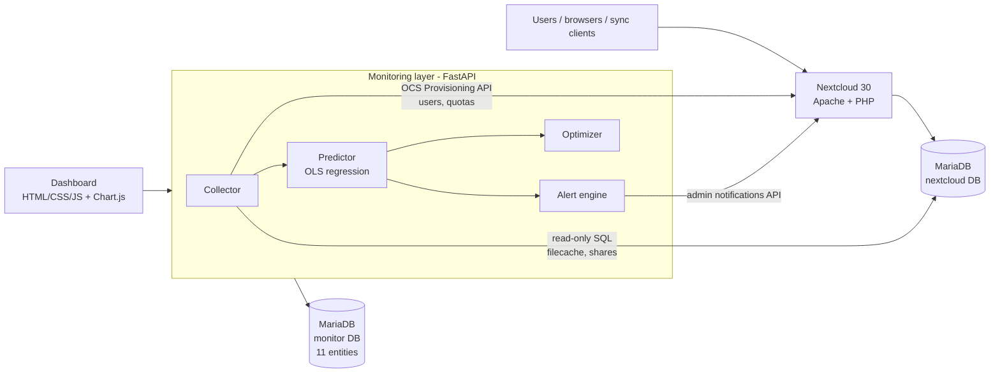
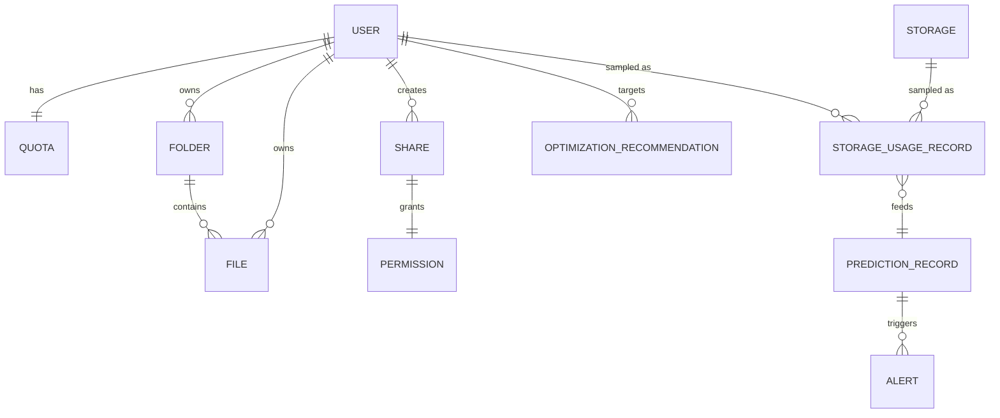

# Predictive Storage Resource Monitoring and Optimization for a Nextcloud-Based Private Cloud

A Nextcloud private cloud (Docker) extended with a lightweight **predictive storage-monitoring layer**:
it collects storage usage, keeps history, fits the growth trend, predicts when capacity (and each user's quota)
will be exhausted, raises proactive alerts (also pushed into Nextcloud's notification bell) and
recommends how to reclaim space.

```
Nextcloud ─▶ Collect usage ─▶ Store history ─▶ Analyse growth ─▶ Predict capacity ─▶ Alerts ─▶ Recommendations
  (OCS API + DB)   (every 30 s)    (MariaDB)     (linear regression)   (days to full)    (warning/critical)   (dashboard)
```

## Architecture



| Container | Image | Port | Purpose |
|---|---|---|---|
| `db` | mariadb:10.11 | – | Nextcloud database + `monitor` database |
| `nextcloud` | nextcloud:30-apache | 8080 | File storage, sync, sharing, users, quotas |
| `monitor` | built from `./monitor` | 8000 | Collector, predictor, alerts, optimizer, REST API, dashboard |

## Running it

### Option A: Demo mode (no Docker, about 1 minute)

Needs only Python 3.10+. A built-in **simulated Nextcloud** (5 users, folders, shares, trash, versions)
feeds the same pipeline, with four usage scenarios and a virtual clock.

```
run_demo.bat
```
or manually:
```
cd monitor
pip install -r requirements.txt
python -m uvicorn app.main:app --port 8000
```
Open http://localhost:8000.

### Option B: Full stack with real Nextcloud (Docker)

1. Install Docker Desktop (Windows: run `wsl --install` in an admin PowerShell, reboot, then install
   Docker Desktop from docker.com and start it).
2. From this folder:
   ```
   docker compose up -d --build
   ```
   The first start takes 2–4 minutes while Nextcloud installs itself.
3. Nextcloud: http://localhost:8080, log in as `admin` / `Admin@Cloud2026`.
   Monitor: http://localhost:8000. All demo logins are listed in [CREDENTIALS.md](CREDENTIALS.md).
4. Create demo users, quotas, folders, shares and initial (partly back-dated) files, then generate growth:
   ```
   pip install httpx
   python scripts/generate_load.py --setup
   python scripts/generate_load.py --scenario rapid      # Ctrl+C to stop; also: steady, spike, stable
   ```
   The storage pool is set to 1 GB (`STORAGE_CAPACITY_GB`), so the "rapid" scenario fills it in about 7 minutes. The generator stops by itself after uploading 1.2 GB (`--max-gb`) to protect the local disk.
   Within a few collections the dashboard shows the trend, the predicted time to full, and quota and
   capacity alerts. The alerts also appear in Nextcloud's notification bell for `admin`.

Stop with `docker compose down` (add `-v` to delete all data).

## Suggested live demo (5 minutes)

1. **Nextcloud** (Option B): log in as admin, show Users (quotas), Files, a share link and permissions.
2. **Dashboard**: KPIs (used %, free, growth/day, predicted time to full), the usage chart with regression
   trend and forecast meeting the capacity line, and the alerts panel.
3. **Users & quotas**: per-user growth and *time to quota full*; dave is close to his quota.
4. **Recommendations**: trash bin, old versions, duplicates, large files, cold data, quota and capacity planning,
   each with its potential saving.
5. **Scenarios** (demo bar): load *Rapid*, then click **+1 day** a few times. The forecast shortens, alerts
   escalate from warning to critical, and the *Forecast history* chart shows how the prediction evolved. Load
   *Stable* to show that no exhaustion is predicted and no alerts are raised.
6. **Evaluation**: `python scripts/evaluate.py` backtests the predictor against ground truth (see below).
7. **Elastic scaling and self-service** (Option B): see the next section.

## Elastic scaling and user self-service

| Feature | Where | How it works |
|---|---|---|
| Pool resize | Dashboard, *Elastic storage pool* | The admin sets the provisioned pool size (up to the volume limit, `POOL_MAX_GB`). |
| Autoscaling | Same card, *Autoscale* | After every collection, if the pool is at least *X*% full, it grows by *Y*% (defaults 85% and 25%). Each step is logged and pushed to the admin's Nextcloud notifications. |
| Quota requests | User portal `/me` → dashboard *Quota requests* | The user asks for extra space with a reason, and the admin is notified. On approval, the quota is changed **in Nextcloud** (OCS Provisioning API) and the user is notified. |
| Direct quota change | Dashboard, *Users & quotas* → *Set quota* | The admin changes a user's quota in Nextcloud. |
| Thin provisioning | *Elastic storage pool* | Shows the sum of all quotas against the pool size (over-commitment). |
| "Storage almost full" | Each user's Nextcloud bell | Sent when a user crosses 80% of their quota. |
| Storage tips | Each user's Nextcloud bell + `/me` | One summary per user: empty the trash bin, old versions, cold files, compressible files, large files. Each tip is sent once and re-armed when it clears. |
| Compression | `/me` → *Compress* | The file is zipped through WebDAV with the user's own credentials, the original is deleted and purged from the trash bin. Already-compressed data (JPEG, MP4, ZIP) is detected and kept. |
| Cold-data clean-up | `/me` → *Files you have not touched in 180+ days* | Delete a file and purge it from the trash bin. |
| Chargeback | Dashboard and `/me` | Monthly cost per user at `COST_PER_GB_MONTH`. |

The user portal (`http://localhost:8000/me`) logs in with the user's own Nextcloud account, so every file
action runs with that user's permissions. The admin never touches users' files.
`python scripts/seed_compressible.py` uploads log/CSV files that compress well, for demonstrating compression.

**Scaling beyond one disk.** The pool resize is the control side of scaling. In production, it calls the
platform to grow the volume (vertical scaling, e.g. resizing an EBS or Azure disk, or LVM). Horizontal scaling
moves Nextcloud's primary storage to S3-compatible object storage (MinIO or Ceph), so capacity grows by adding
storage nodes. More Nextcloud application containers run behind a load balancer, with Redis and a replicated
MariaDB.

## Database entities (monitor database)

| Entity | Table | Source / role |
|---|---|---|
| User | `users` | Nextcloud users (OCS API): role, enabled, last login |
| Quota | `quotas` | Per-user quota and used bytes |
| Storage | `storage` | Storage pool: capacity, used, files / trash / versions breakdown |
| Folder | `folders` | Folder inventory (from `oc_filecache`) |
| File | `files` | File inventory incl. trash bin and versions areas |
| Share | `shares` | User, group and public-link shares (`oc_share`) |
| Permission | `permissions` | Decoded share permission bitmask (read/update/create/delete/share) |
| StorageUsageRecord | `storage_usage_records` | Time series of usage, system-wide and per user |
| PredictionRecord | `prediction_records` | Growth rate, R², days remaining, predicted full date per cycle |
| Alert | `alerts` | Utilization and predictive alerts, warning/critical, open/resolved |
| OptimizationRecommendation | `optimization_recommendations` | Rule-based space-saving advice with estimated saving |
| PoolConfig | `pool_config` | Provisioned pool size, volume limit and autoscaling policy |
| QuotaRequest | `quota_requests` | Users' requests for more space and the admin's decision |
| ScalingEvent | `scaling_events` | Audit log: pool resizes, quota changes, compression, clean-ups |
| RecommendationNotice | `recommendation_notices` | Storage tips already sent to each user (prevents repeat notifications) |



## Prediction method

For each scope (the whole pool and every user) an ordinary least-squares line `used = a + b·t` is fitted to the
usage samples inside a sliding window (default 7 days, `PREDICTION_WINDOW_DAYS`). The slope `b` is the growth
rate, and the time remaining is `(capacity − used_now) / b`. R² is reported as a confidence indicator. If `b ≤ 0`
the resource is reported as *not filling*.

**Alert rules** (configurable): utilization ≥ 80 % warning / ≥ 90 % critical; predicted exhaustion ≤ 14 days
warning / ≤ 3 days critical. The same rules apply to user quotas. Alerts are de-duplicated, escalated, and
auto-resolved when the condition clears.

**Optimization rules**: large files (> 100 MB), compressible files (text, logs, CSV, BMP, WAV, uncompressed tar),
duplicates (same name and size), trash bin > 50 MB, old versions > 50 MB, cold data (not modified for 180+ days),
users near quota or heavy users without a quota, and capacity expansion needed for the next 30 days of growth.
The Docker stack scales these thresholds down to the small demo pool (see `docker-compose.yml`).

### Evaluation summary

`scripts/evaluate.py` cuts the simulated history at several points, predicts, and compares the prediction with
the true exhaustion time. Full table: [docs/evaluation.md](docs/evaluation.md).

- **Steady growth**: accurate (error under 1 day with a 30-day window, 2–4 days with short windows).
- **Accelerating growth**: short windows (3–7 days) track the acceleration best. Long windows are too optimistic.
- **Sudden spike**: a one-off bulk upload inflates the short-window slope, so the predictor warns early
  (conservative, a false-positive warning). It recovers once the spike leaves the window. This is a known
  limitation of linear trend models, and a future-work item (e.g. robust regression or Holt smoothing).
- **Stable usage**: correctly predicts no exhaustion, and no alerts are raised.

## Configuration (environment variables)

| Variable | Default | Meaning |
|---|---|---|
| `MONITOR_MODE` | `demo` | `demo` (simulator) or `nextcloud` |
| `DATABASE_URL` | `sqlite:///./monitor.db` | Monitor database (MariaDB in Docker) |
| `NEXTCLOUD_URL`, `NEXTCLOUD_ADMIN_USER`, `NEXTCLOUD_ADMIN_PASSWORD` | | OCS API access |
| `NEXTCLOUD_DB_URL` | – | Read-only access to Nextcloud's DB for the file and share inventory |
| `STORAGE_CAPACITY_GB` | `10` (`1` in compose) | Size of the storage pool being forecast |
| `COLLECT_INTERVAL_SECONDS` | `60` (`30` in compose) | Collection period |
| `PREDICTION_WINDOW_DAYS` | `7` | Regression window (days) |
| `PREDICTION_WINDOW_MINUTES` | – (`15` in compose) | Overrides the window in minutes; the live demo grows over minutes, not days |
| `ALERT_UTIL_WARN` / `_CRIT` | `80` / `90` | Utilization thresholds (%) |
| `ALERT_DAYS_WARN` / `_CRIT` | `14` / `3` | Predicted-exhaustion thresholds (days) |
| `LARGE_FILE_MB`, `OLD_FILE_DAYS`, `TRASH_MIN_MB`, `VERSIONS_MIN_MB` | 100, 180, 50, 50 | Optimizer rules |
| `OLD_FILES_MIN_MB` | 100 | Minimum cold data per user before the cold-data tip is shown |
| `NOTIFY_NEXTCLOUD` | `true` | Push alerts and tips to the Nextcloud notifications of the admin and the users |
| `POOL_MAX_GB` | `5` | Volume limit: the pool cannot be resized or autoscaled beyond it |
| `COST_PER_GB_MONTH`, `CURRENCY` | `2.0`, `Rs.` | Chargeback rate |
| `MONITOR_PUBLIC_URL` | `http://localhost:8000` | Portal link used in user notifications |

## REST API

| Method | Path | Description |
|---|---|---|
| GET | `/api/overview` | KPIs, latest prediction, alert counts, entity row counts |
| GET | `/api/history?scope=system\|user&user=&days=` | Usage time series + regression forecast |
| GET | `/api/users` | Users, quotas, trash/versions, per-user prediction |
| GET | `/api/alerts?include_resolved=` | Alerts |
| GET | `/api/recommendations` | Open recommendations |
| POST | `/api/recommendations/{id}/dismiss` | Dismiss a recommendation |
| GET | `/api/consumers` | Largest files and usage by file type |
| GET | `/api/shares` | Shares with decoded permissions |
| GET | `/api/predictions` | History of system forecasts |
| POST | `/api/collect` | Run a collection cycle now |
| POST | `/api/demo/reset`, `/api/demo/advance` | Demo mode: load scenario / advance virtual clock |
| GET | `/api/admin/scaling` | Pool, autoscaling policy, quota requests, scaling log |
| POST | `/api/admin/pool` | Resize the pool / set the autoscaling policy |
| POST | `/api/admin/users/{uid}/quota` | Change a user's quota in Nextcloud |
| POST | `/api/admin/quota-requests/{id}/approve\|deny` | Decide a quota request |
| POST | `/api/me/login` | User portal login (Nextcloud credentials) |
| GET | `/api/me` | The user's usage, tips, cold and largest files, requests |
| POST | `/api/me/quota-request`, `/api/me/compress`, `/api/me/delete`, `/api/me/empty-trash` | Self-service actions |

Interactive API docs: http://localhost:8000/docs

## Project structure

```
docker-compose.yml        Nextcloud + MariaDB + monitor
db/init/01-monitor-db.sh  creates the monitor DB and a read-only grant on Nextcloud's DB
monitor/
  Dockerfile, requirements.txt
  app/
    main.py               FastAPI app: REST API, dashboard, scheduler start-up
    config.py             environment configuration
    db.py                 SQLAlchemy models (15 entities)
    collector.py          monitoring pipeline (collect -> store -> predict -> alert -> recommend)
    predictor.py          least-squares growth analysis and exhaustion prediction
    alerts.py             threshold and predictive alerts, de-dup/escalate/resolve, notifications
    optimizer.py          storage-optimization recommendation rules, per-user storage tips
    scaling.py            pool resize, autoscaling, quota requests, scaling log
    selfservice.py        user portal actions over WebDAV (compress, delete, empty trash)
    sources/nextcloud.py  real Nextcloud: OCS API + read-only SQL on oc_filecache/oc_share
    sources/simulator.py  simulated Nextcloud with growth scenarios (demo/evaluation)
    static/               admin dashboard (index.html, app.js) and user portal (me.html, me.js)
scripts/
  generate_load.py        creates users/quotas/shares and generates uploads on real Nextcloud
  seed_compressible.py    uploads compressible log/CSV files (compression demo)
  evaluate.py             backtests the predictor under different scenarios
docs/evaluation.md        evaluation results
run_demo.bat              one-click demo mode on Windows
simulate_upload.bat       one-click upload simulation against the Docker stack
```
